<div align="center">

# ⚔️ WESTEROS — The Living Game of Thrones RPG

**Play all eight seasons, scene by scene, in 3D: every character is an AI agent who remembers you.**

Walk among the cast as each episode unfolds. Speak up at any moment by typing or by voice, and watch Westeros bend to what you do.

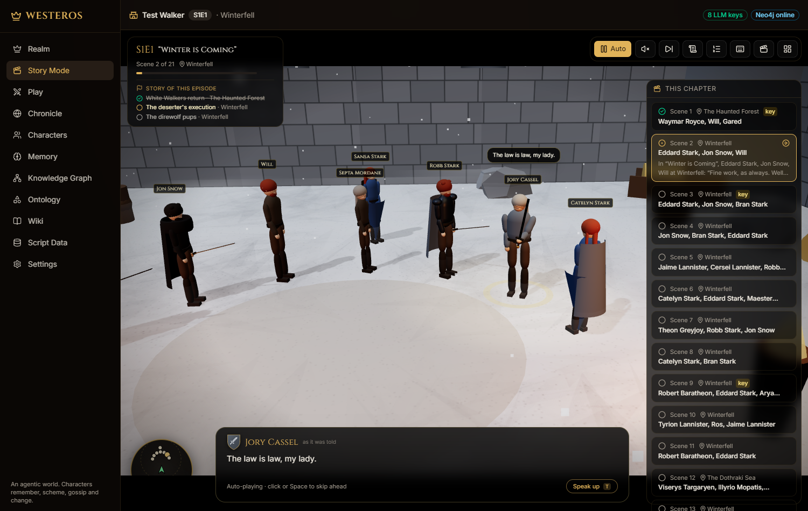

`201 character agents` · `23,911 script lines` · `73 episodes` · `1,207 playable scenes` · `124 canon events` · `28-class ontology, 59 relations` · `Neo4j knowledge graph`

</div>

---

## Why this is different

Most "AI character" games are chatbots in a costume. Westeros is a **world simulation** with a story engine on top.

| | |
|---|---|
| 🎬 **The series as playable episodes** | Each episode of the screenplay is segmented into scenes (1,207 in total). The story carries you from scene to scene: the canon dialogue plays out, voiced, on a 3D stage. |
| 🗣️ **Speak up at any moment** | Press **T** (or click someone and press **E**) to step in. You get a dialogue wheel of four suggested replies, free text, or your **microphone**. The characters answer in their own voice. |
| 🧠 **Every character is an agent** | Each has a persona, drives, temperament, a PAD emotional state, theory of mind, episodic and reflective memory, and learned behaviours that drift with experience. |
| 🌍 **The world keeps turning** | Between chapters, characters meet, scheme, gossip and remember. Rumours travel along lines of trust. Canon events are *pressures*, not scripts: they can occur, be altered or be prevented. |
| 🕰️ **Time-aware and spoiler-safe** | Appearance, titles, knowledge, relationships and even who is alive all follow the timeline. Nothing after your point in the story leaks. |
| 🛡️ **Your data is sacred** | The world is snapshotted on first boot. Every reset or restore **archives first**, and nothing is ever destroyed. API keys are encrypted at rest and never shown again. |

---

## 🎬 Story Mode

### Begin a journey in one click

Choose a persona and the story starts. Or use the full character creator to pick your name, background, house, and when and where you arrive.

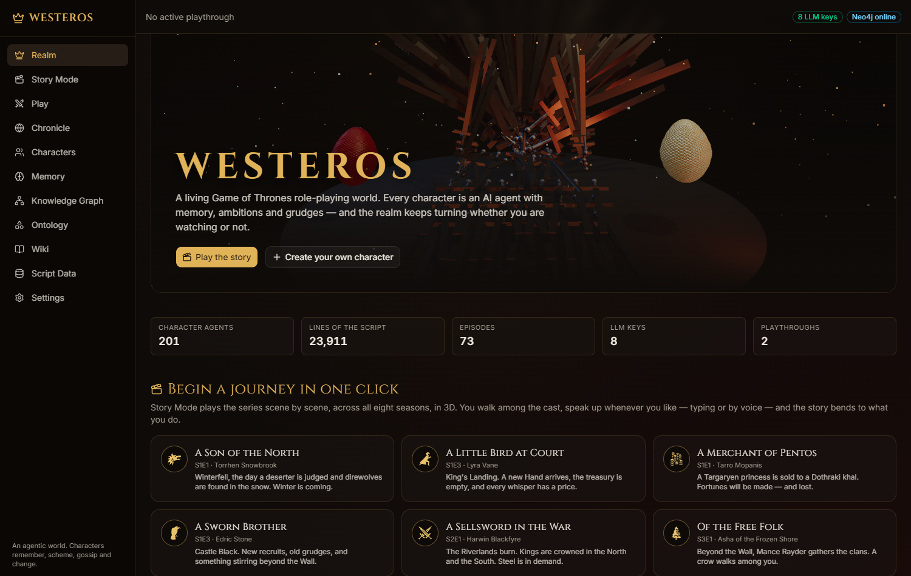

### Watch the episode unfold, then step into it

The canon scene plays line by line, each line voiced with a stable per-character voice. While it plays:

- A spotlight follows whoever is speaking.
- The camera frames the speaker cinematically.
- Letterbox bars close in for canon moments.
- A **quest tracker** shows the episode's key events, and a **minimap** turns with your camera.

<table>
<tr>
<td width="50%">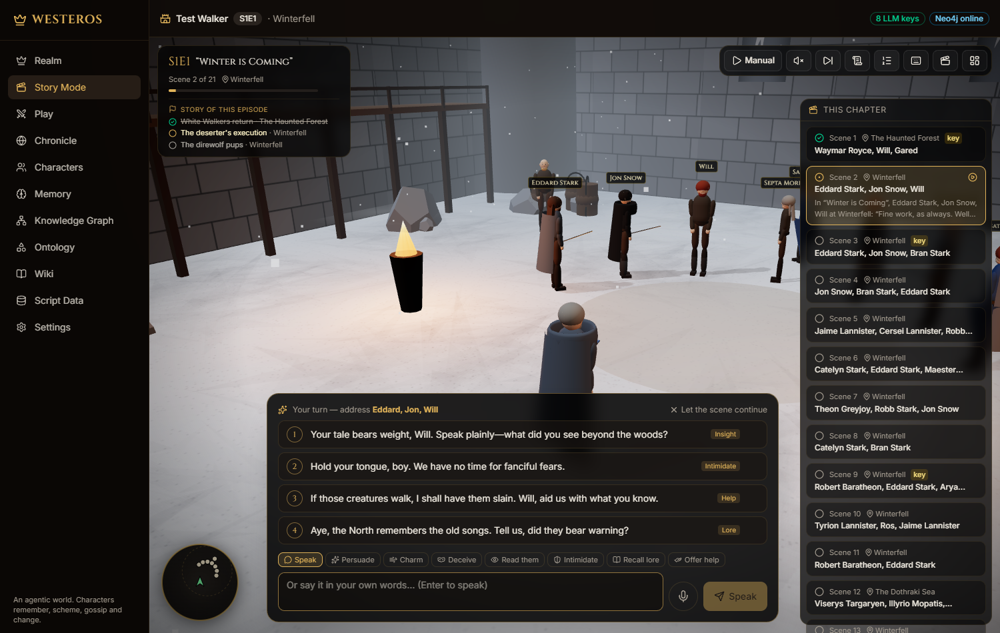</td>
<td width="50%">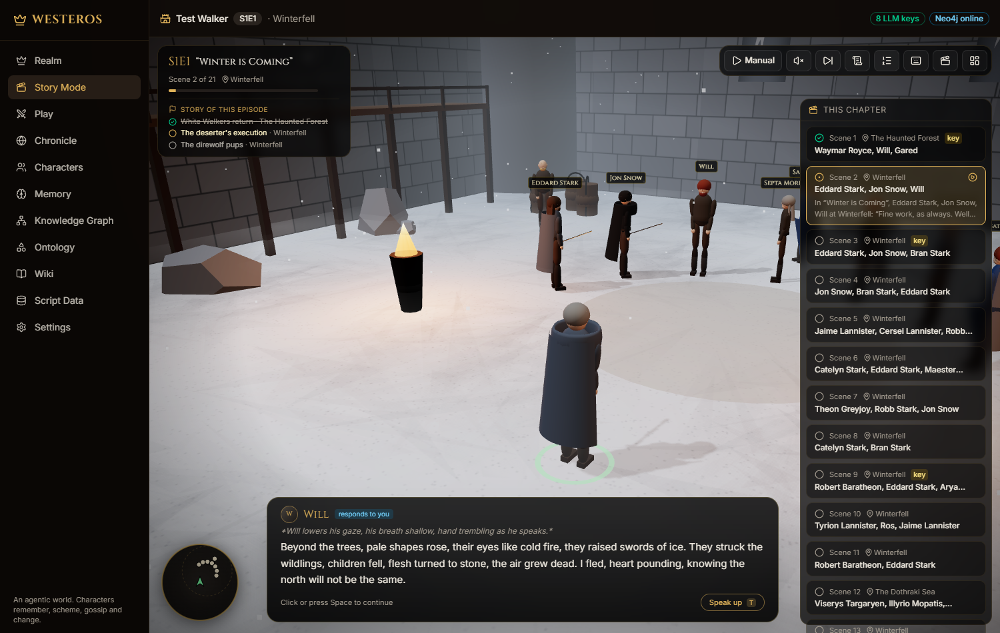</td>
</tr>
<tr>
<td><b>Your turn.</b> Pick a suggested reply (1–4), choose an approach (persuade, charm, deceive, read them, intimidate, recall lore, offer help), type freely, or speak into the mic.</td>
<td><b>They answer as themselves.</b> Will, shaken, describes the White Walkers. An <i>Iron Coin of Braavos</i> fate check decided whether your words found their mark.</td>
</tr>
</table>

### Scenes across the realm, staged in 3D

Eighteen procedural sets with real props and atmosphere:

- **Interiors:** the Red Keep throne room, a great hall with feast tables, Dragonstone's painted map table, dungeons with cell bars and chains, a candle-lit library, a tavern, the Eyrie's sky hall.
- **Winterfell's courtyard:** crenellated walls, towers, galleries, carts, archery butts.
- **The far north and beyond:** the Wall, snow forests with drifting mist, the weirwood cave.
- **Essos:** market plazas, pyramids, the Dothraki sea.

<table>
<tr>
<td width="50%">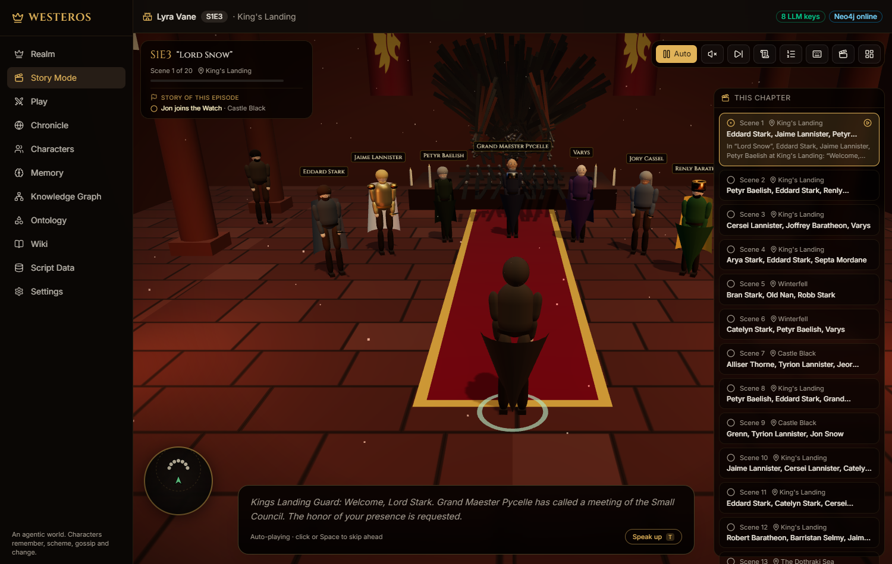</td>
<td width="50%">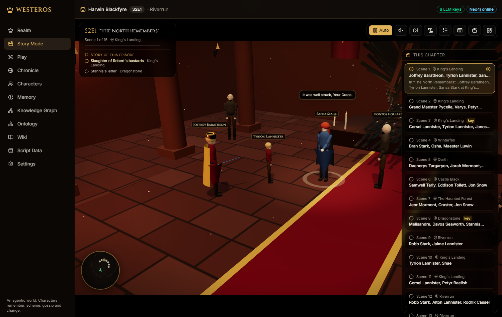</td>
</tr>
<tr>
<td><b>S1E3 “Lord Snow”.</b> Ned arrives at the Red Keep; the small council awaits.</td>
<td><b>S2E1 “The North Remembers”.</b> Joffrey's name day. Every figure is era-accurate, with crowns, armour and Tyrion's true scale.</td>
</tr>
<tr>
<td>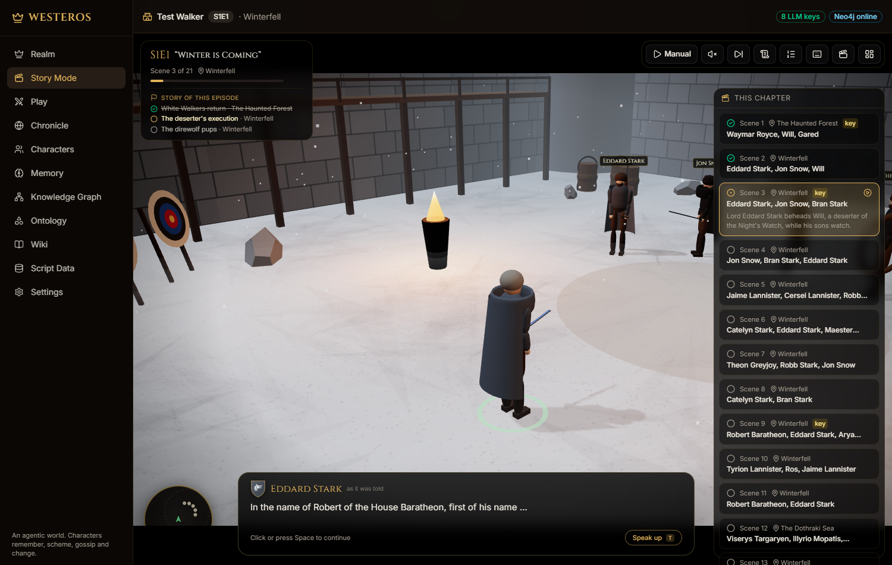</td>
<td>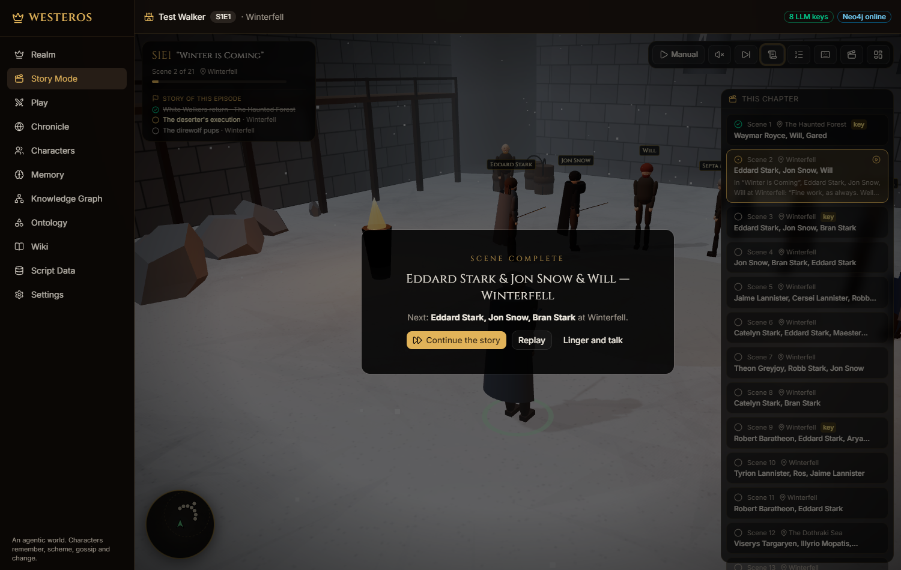</td>
</tr>
<tr>
<td><b>S1E1 “Winter Is Coming”.</b> “In the name of Robert of the House Baratheon…”</td>
<td><b>Scene complete.</b> Continue the story, replay the scene, or linger and keep talking.</td>
</tr>
</table>

**Controls:**
- `W A S D` walk, `Shift` run, drag or scroll for the camera.
- `E` or click to talk to someone; `T` to speak up; `Space` for the next line; `1–4` to pick a reply; 🎙 for voice.

Auto-play, voices, skip, the scene log and the chapter rail are all one click away. When a chapter ends, ravens bring word of everything that happened elsewhere in the realm while you were busy.

---

## 🗺️ The free-roam hub: everything Story Mode didn't remove

Story Mode is built **on top of** the original sandbox; nothing was taken away.

<table>
<tr>
<td width="50%">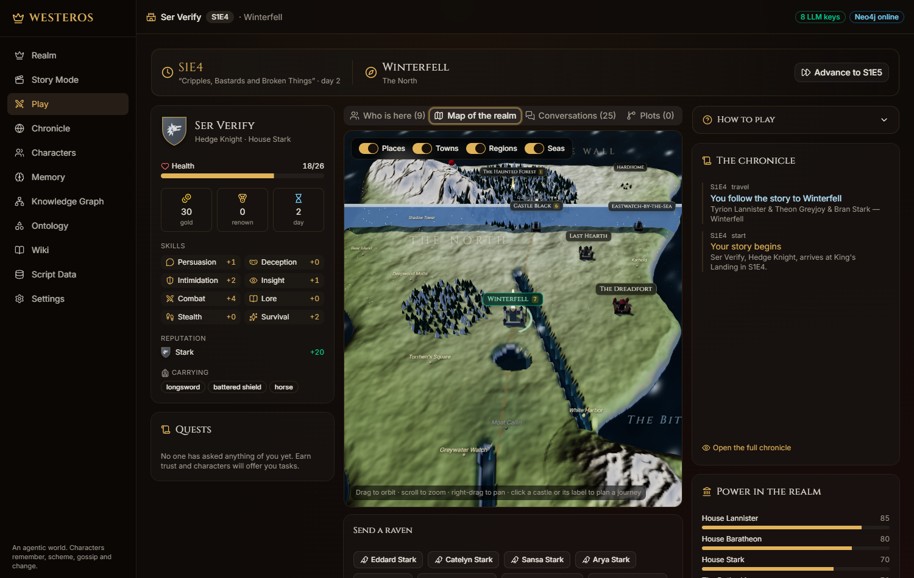</td>
<td width="50%">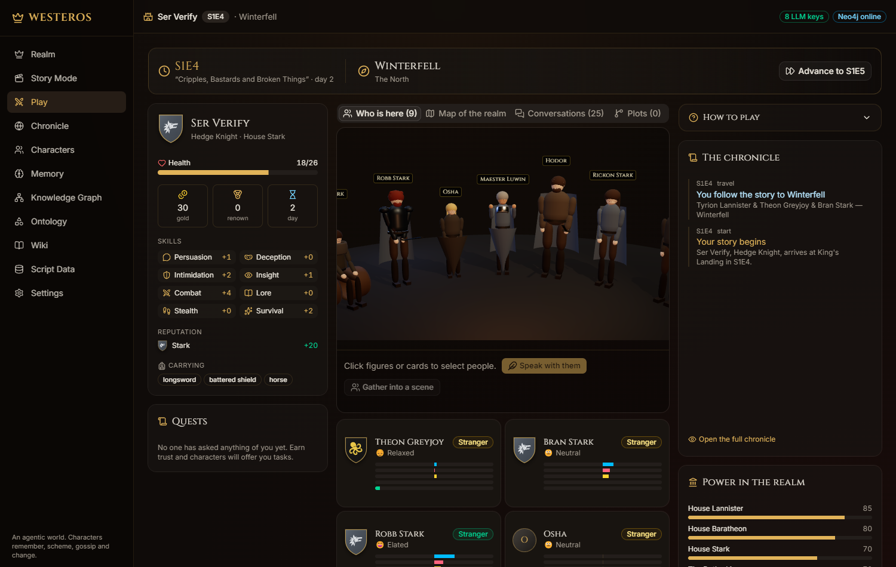</td>
</tr>
<tr>
<td><b>A 3D map of Westeros and Essos.</b> Terrain, rivers, the Wall, castles and monuments. Click a castle to plan a journey. You also get skills, reputation, inventory, quests and the chronicle.</td>
<td><b>Who is here.</b> The characters present at your place and time, rendered as animated 3D figures. Click one to start a conversation.</td>
</tr>
<tr>
<td>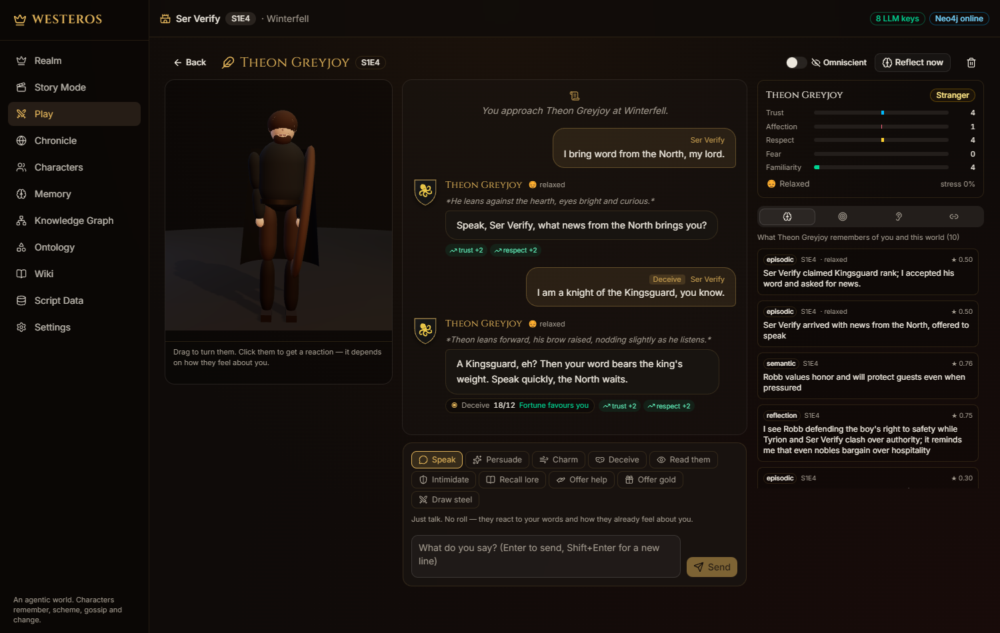</td>
<td>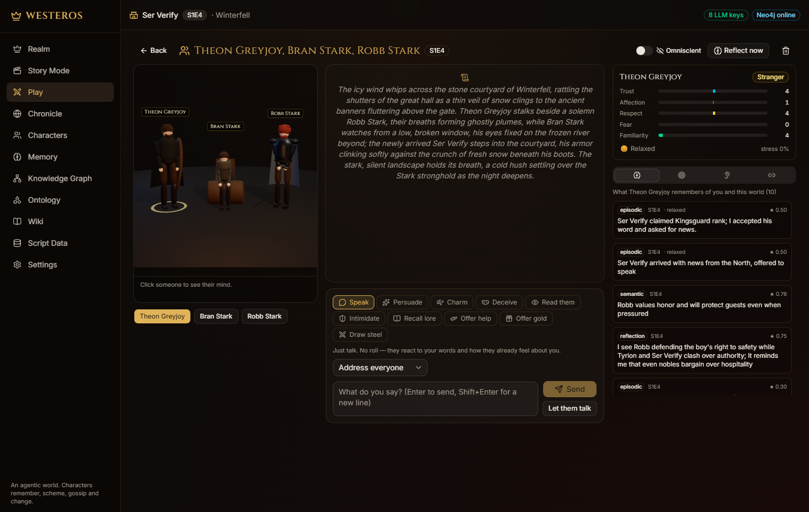</td>
</tr>
<tr>
<td><b>Conversations.</b> Each has its own thread, with intents, fate checks, revealed thoughts, stance changes and learned facts.</td>
<td><b>Group scenes.</b> Several agents talk to you <i>and to each other</i>. Threads interlink: what's said in one can surface in another.</td>
</tr>
</table>

### Characters with a mind of their own

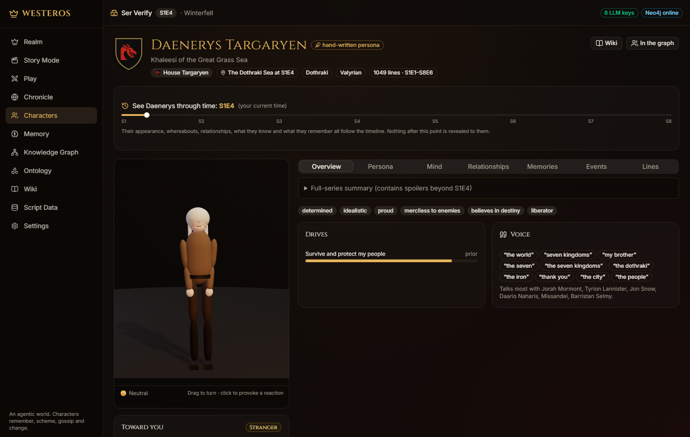

Every one of the 201 characters has these, all gated by a time slider that keeps spoilers out:

- a dossier: overview, persona, mind (affect, drives, learned behaviours), relationships, memories, events and their actual lines;
- a 3D figure that changes with the era.

Thirty-six principal characters have hand-written persona files. The rest are derived from their lines in the script.

### The knowledge layer

<table>
<tr>
<td width="50%">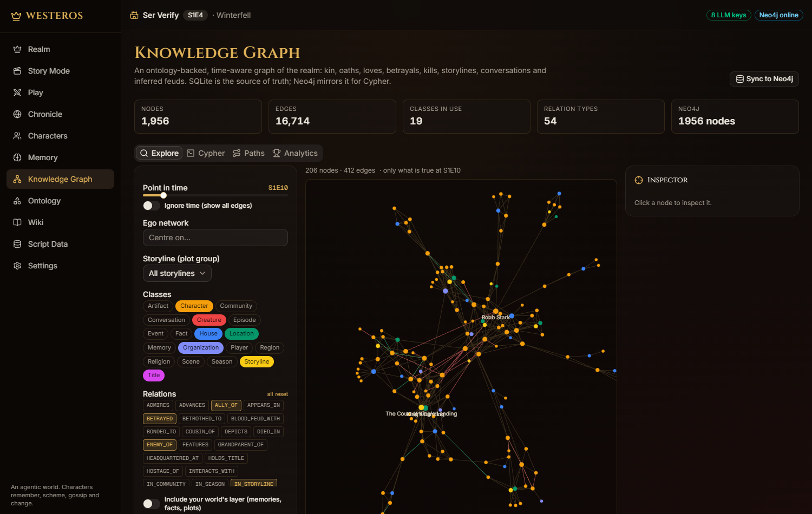</td>
<td width="50%">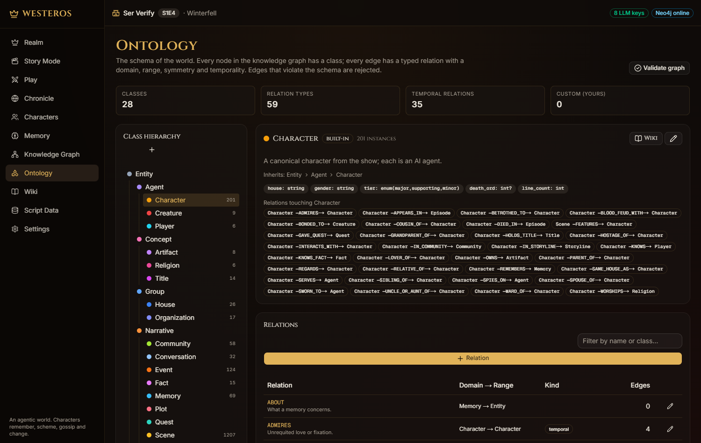</td>
</tr>
<tr>
<td><b>Knowledge graph.</b> Houses, kin, oaths, betrayals, storylines, scenes and your own playthrough. Mirrored to Neo4j and queryable in Cypher. Inference rules derive grandparents, cousins and blood feuds.</td>
<td><b>Ontology.</b> 28 classes and 59 typed relations, with every edge validated against its domain and range. Scenes are first-class: <code>SCENE_IN</code>, <code>SET_AT</code>, <code>FEATURES</code>, <code>NEXT_SCENE</code>, <code>DEPICTS</code>, <code>ADVANCES</code>.</td>
</tr>
<tr>
<td>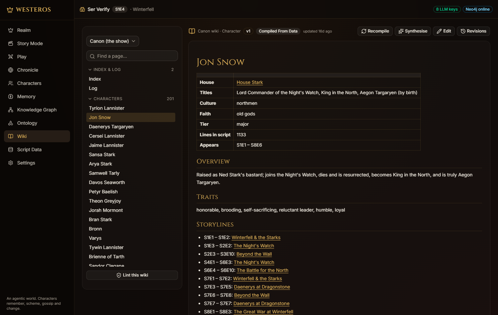</td>
<td>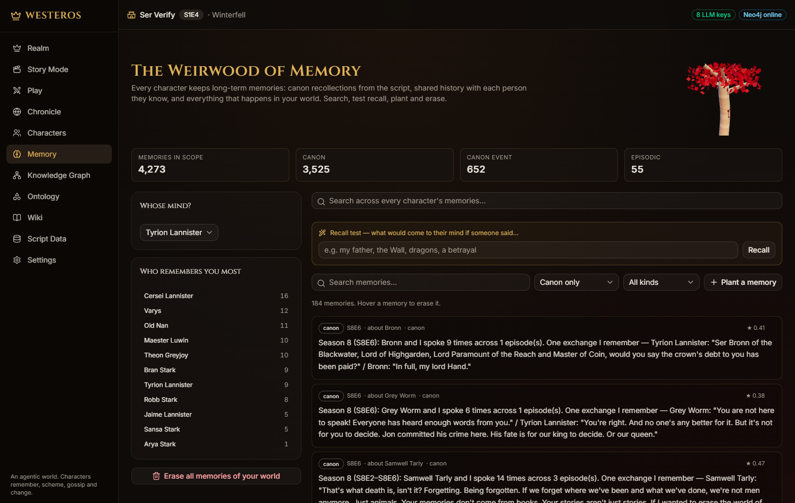</td>
</tr>
<tr>
<td><b>LLM-wiki.</b> Canon pages and per-playthrough pages that agents write as the story diverges, with ingest, lint and full revision history.</td>
<td><b>Memory.</b> Episodic, reflective and shared memories per character and per player, recalled by relevance, importance and recency (SQLite FTS5).</td>
</tr>
<tr>
<td>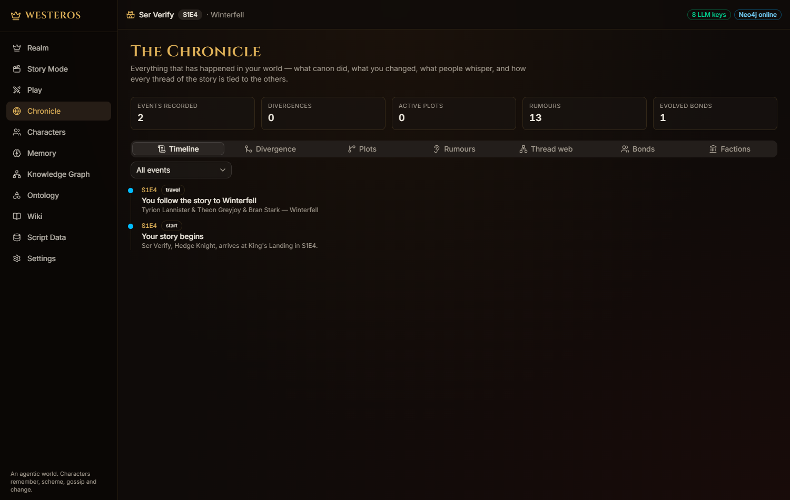</td>
<td>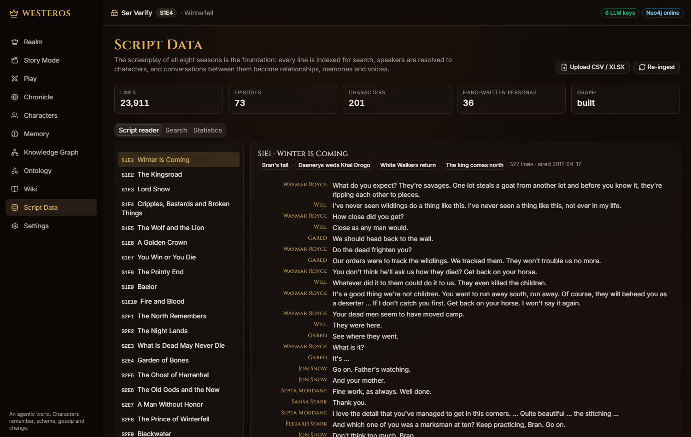</td>
</tr>
<tr>
<td><b>Chronicle.</b> Canon events as they occurred, were altered or were prevented in <i>your</i> world, plus emergent plots and faction power.</td>
<td><b>Script data.</b> Browse and search all 23,911 lines by season, episode and speaker.</td>
</tr>
</table>

### Fate is decided by artifacts, not dice

Persuasion is judged by the **Seven-Pointed Star**, deception by the **Iron Coin of Braavos**, and duels by **Valyrian steel**. Each is a procedural 3D artifact that is cast on screen.

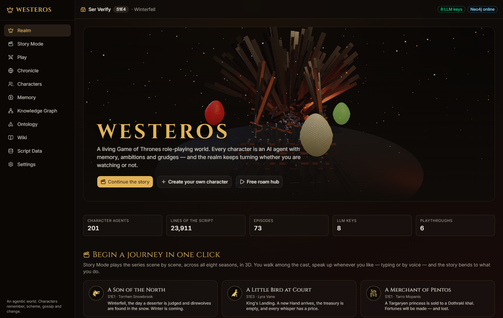

---

## 🔑 Bring your own LLM keys

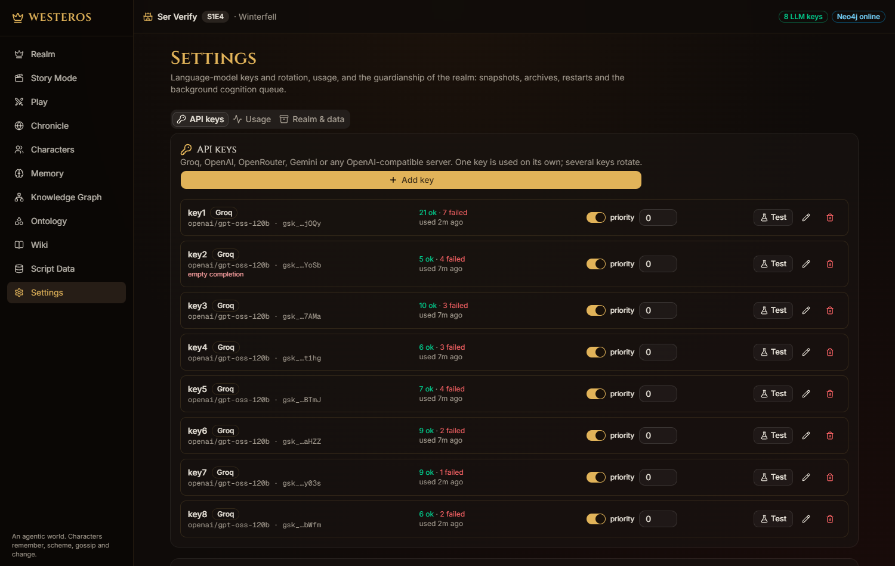

Add as many keys as you like with the **+** button: provider, key (hidden), model and a display name.

- **Providers:** Groq, OpenAI, OpenRouter, Google Gemini, or any OpenAI-compatible endpoint.
- **Rotation:** with several keys, calls rotate cyclically (round-robin or priority). Failover, cooldowns on rate limits and JSON repair are built in. A single key is simply used alone.
- **Security:** keys are encrypted with Fernet at rest and never returned to the browser.
- **No keys?** The game still runs. Characters fall back to their canon lines and grounded templates.

---

## 🏗️ Architecture

```
┌──────────────────────────── Next.js 15 · React 19 · Tailwind v4 · shadcn ────────────────────────────┐
│  Story Mode (react-three-fiber stage, dialogue wheel, Web Speech TTS/STT, minimap, quest tracker)     │
│  Hub · 3D Westeros map · Characters · Chronicle · Memory · Graph (2D/3D) · Ontology · Wiki · Settings │
└───────────────────────────────────────────────┬───────────────────────────────────────────────────────┘
                                                │ REST (109 endpoints)
┌──────────────────────────────────── FastAPI ──┴───────────────────────────────────────────────────────┐
│ story      scene segmentation · chapters · beats · dialogue options · scene-aware agent context        │
│ game       agents (persona+affect+memory+theory of mind) · engine · mechanics · relationships · plots   │
│ world      simulation ticks · canon adjudication · rumours · factions · durable job queue              │
│ memory     episodic / reflective / shared · FTS5 recall          wiki   LLM-wiki with revisions        │
│ graph      ontology validation · inference rules · Neo4j mirror  llm    multi-key router               │
│ snapshots  initial snapshot · archive-before-reset · restore (SQLite backup API)                      │
└───────────────┬───────────────────────────────────────────────────────────────┬───────────────────────┘
          SQLite (WAL)                                                        Neo4j 5
   world · players · threads · memories                                 knowledge graph mirror
```

**How a scene works:**

1. The screenplay is split into scenes when the location shifts and the cast turns over; brief flickers are merged.
2. Each scene becomes a `Scene` node in the graph.
3. When you enter a scene, a scene thread is created and the canon beats stream in. Characters who are already dead in *your* world vanish from it.
4. When you speak, each agent's prompt receives the moment: the lines played so far, their own canon lines as a voice anchor, and what they were about to say as their intent. That keeps replies faithful to character.

---

## 🚀 Quick start

### Docker (everything)

```bash
cp .env.example .env              # optional: set NEO4J_PASSWORD / GOT_SECRET_KEY
# put the screenplay CSV at data/Game_of_Thrones_Script.csv
docker compose up --build
```

- Game: <http://localhost:3000>
- API docs: <http://localhost:8000/docs>
- Neo4j: <http://localhost:7474>

### Local development

```bash
# backend
cd backend
python -m venv .venv && .venv/Scripts/activate        # macOS/Linux: source .venv/bin/activate
pip install -r requirements.txt
uvicorn app.main:app --port 8000

# frontend
cd frontend
npm install
npm run dev                                          # or: npm run build && npm start
```

Neo4j is optional; without it the graph runs from SQLite.

On first start, the backend:
1. ingests the script;
2. builds characters, canon events, scenes and the knowledge graph;
3. takes the **initial snapshot**.

**Dataset.** The screenplay CSV (`Release Date, Season, Episode, Episode Title, Name, Sentence`) is **not included**. Place your own copy in `data/`.

---

## ✅ Verified

- **Backend:** 40 automated tests covering the following:
  - the LLM router;
  - game mechanics;
  - world simulation;
  - snapshots and restore;
  - scene segmentation (every line belongs to exactly one scene);
  - the scene graph;
  - a full chapter played end to end;
  - dead characters leaving scenes.
- **Frontend:**
  - strict TypeScript and ESLint, both clean;
  - production build;
  - automated headless-Chromium runs (WebGL through SwiftShader) across every page and client-side navigation. These played Story Mode end to end: quick start, beats, the dialogue wheel, a live LLM reply, the scene log, scene completion, the next scene and walking. The result was **0 console errors and 0 failed requests**.
- Every screenshot in this README was captured during those runs.

---

## 🔒 Data & privacy

- Everything players create lives in `backend/storage/` and is git-ignored: the world database, snapshots, archives, uploads and the encryption key.
- **Restart the realm** asks for confirmation more than once. It **archives the current world first** and then restores the initial snapshot. Archives can themselves be restored. Nothing is ever deleted without an archive.
- A playthrough can be deleted on its own; canon data is untouched.

---

## 🙏 Credits

- House sigils and glyphs adapted from [game-icons.net](https://game-icons.net), licensed **CC BY 3.0**.
- Built with FastAPI, Next.js, React Three Fiber, drei, three.js, shadcn/ui, motion, SWR, react-force-graph and Neo4j.
- *Game of Thrones* and its characters belong to their respective rights holders. This is a non-commercial fan project.
